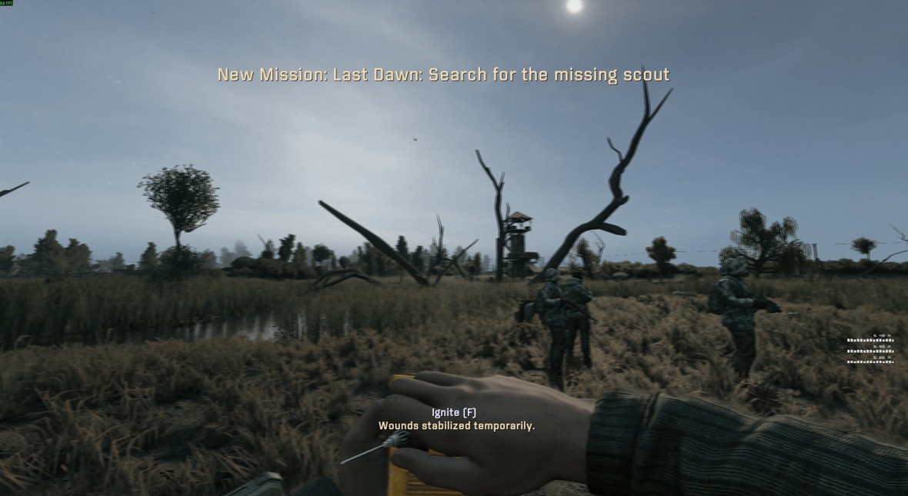

# Unholy's Field Medical Mod

Field Medical is one standalone S.T.A.L.K.E.R. addon for blood loss, fractures, tourniquets, and the medical item catalog. Health tracks blood volume. Penetrating hits produce individual wounds whose bleeding adds up. Fractures and tourniquet injuries affect movement and handling independently of blood volume.



*A medkit temporarily stabilizes wounds in the Great Swamps on Romeo DX11.*

## Treatment

- A bandage slows the worst undressed wound. The wound continues to bleed.
- Every medkit tier can stabilize wounds at every severity. One wound requires one to four treatment units by default. Standard, army, scientific, and optional elite medkits supply 2, 4, 7, and 9 units. Partial treatment survives saving and loading. Completed stabilization lasts five minutes. When it expires, dress the reopened wound with a fresh bandage before treating it again.
- Epinephrine temporarily suppresses the effects of low blood volume. Bleeding and limb penalties continue.
- A splint stabilizes an arm or leg fracture once, with no expiry. Leg fractures slow movement and block sprinting until splinted. Arm fractures add sway and slow reloads. Rib fractures reduce stamina capacity and regeneration.
- A tourniquet targets the worst bleeding eligible arm or leg. It stops bleeding on that limb and deducts its allocated share of current blood. Medkits can still stabilize its wounds. Left Alt + T removes the active tourniquet closest to expiring. After manual removal or ten minutes, unsealed wounds resume bleeding and the limb has the full corresponding movement or handling penalties. Only doctor treatment clears tourniquet damage and permits reapplication to that limb.
- A doctor's paid injury treatment closes all wounds and clears fractures and tourniquet damage. The combined radiation service also removes radiation. Blood volume is unchanged by either service.
- Sleeping gradually restores blood when bleeding is under control. Food and water improve the recovery rate. Open, stabilized wounds limit recovery until a doctor closes them. Sleeping while bleeding advances blood loss, and an expired stabilization can start bleeding during sleep.
- Blood loss caps stamina, lowers movement acceleration, increases weapon recoil, and impairs vision on supported engines. At critical volume the actor briefly blacks out and loses movement and combat input. Continued bleeding can kill.

The inventory summary shows fractures, splints, and tourniquet status and time remaining. Limb deterioration is internal. Stabilization, epinephrine, and tourniquets use active simulation time. Save/load preserves remaining time and sleep advances it using the configured simulation rate. The adapter caps oversized frame intervals.

## Install

Install the finished ZIP as one MO2 entry after item rebalance patches. Replace the previous Field Medical preview when upgrading. The addon reuses existing treatment items, animations, doctor actions, and sleeping mechanics. Its additive patches supply a basic field splint and an alternate tourniquet for profiles without existing ones. Unholy's Stock Prices Mod can set the doctor's fees while Field Medical handles the treatment.

| Game | Installation | Verification |
| --- | --- | --- |
| Romeo in solo mode | Use the Romeo ZIP. It supplies xrRazom's script hooks. | Tested in game on Romeo DX11. |
| Standalone Anomaly 1.5.3 with Monolith | Build a ZIP against your unpacked game. Install through MO2 or merge its `gamedata` folder into your game. | Local source hooks and LuaJIT tests passed. In-game verification is pending. |
| G.A.M.M.A. with Monolith | Disable Actor Damage Balancer and Body Health System. Build a ZIP against your active MO2 profile. | Local source hooks passed against the checked profile. In-game verification is pending. |

Use a solo Monolith-family X-Ray build with the native post-calculation hit hook, bullet impact and actor pre-hit callbacks, `SetHealthEx`, `ClearWounds`, the usual Anomaly callback loader and the default Anomaly doctor actions. The adapter requires native actor health in the range 0–1. Fracture penalties use the movement, stamina, camera, and animation callbacks available in the engine. Limping is a first-person gait effect.

Solo Romeo DX11 tests exercised starter loadouts, saved fetch migration, quest rewards, the item-use veto, bleeding wounds, bandaging, medkit stabilization, tourniquet application and doctor treatment. LuaJIT tests also cover fracture states, treatment timing, and saved medical state.

Disable Grok Actor Damage Balancer and Body Health System, including the Direct Limb Healing fork, before enabling Field Medical's injury system. Grok intercepts hits upstream and commits its own damage and bleeding before the native post-calculation hook can run. Body Health System intercepts item use and doctor actions and maintains competing per-limb conditions. The addon logs either conflict and leaves the medical catalog active independently. Remove the ZIP to undo both the catalog and the item overrides.

The current adapter targets solo play, including xrRazom with hosting disabled. Keep it off in multiplayer profiles. The model produces a versioned plain-data snapshot that a future multiplayer adapter can replicate.

## Medical catalog

The allowlist uses the `bandages`, `medkits`, `epinephrine`, `fracture_splints`, and `tourniquets` sections. Sections with the `i_medical` kind outside those lists are blocked. Put mod-specific medicine with a different kind in `catalog_excluded`. Food and water stay in their original categories.

The catalog filters both New Game panels, including starting items injected by other addons. The source hooks filter the stock list before random selection and again before the game spawns the selected kit. They also omit unsupported medicine from randomly generated base-game corpse and stash loot. The menu adapter removes any rejected picks and refunds their points.

The native item-use gate rejects disallowed medicine before stock effects or item consumption. The adapter filters trader restocks, trade checkout, NPC inventories, ZML randomized loot, and crafting. The original section definitions, quest items, and existing player inventory objects are retained for save and script compatibility. Packs with custom supply scripts or direct item consumption need an adapter for those paths.

Generated fetch tasks omit blocked medicine when making offers. Existing requests for disabled medicine use the first available item in `fetch_replacements` while keeping their original quantity and payment. Authored quest requirements retain their configured items. Specific incidental rewards in Mortal Sin and Last Dawn substitute usable medical supplies. Skinflint's Freedom infiltration task substitutes its optional medicine and accepts previously collected legacy items towards the bonus on existing saves.

## Hit and engine compatibility

- Gunshot penetration uses `hit.fire_wound` and the actual hit bone. The adapter samples native outfit and helmet armor before impact wear, then checks the matched cartridge's AP and the weapon's configured AP modifier. It supports the ordinary and alternate Monolith armor thresholds. A stopped shot leaves armor wear in the native engine and creates no bleeding wound. A round with incomplete AP or armor data keeps its native impact damage and creates no custom wound. Custom executables or mods that change live AP independently of the cartridge configuration need an adapter that supplies the resolved penetration outcome.
- `hit.wound` and `hit.wound_2` are treated as penetrating injuries when the post-calculation hook reports positive damage. This covers melee and mutant attacks emitted as wound types. Attacks emitted as strikes, explosions, burns, radiation, electrical, or psychic damage keep their native immediate harm. The blood model observes that loss without adding a penetrating wound.
- Base post-calculation damage arrives after native armor and immunity calculation and before HP or wounds are committed. Medical item use is reported after native item effects, so the scoped DLTX patch zeroes the stock health and native wound fields before use. Current blood volume suppresses sustained health restoration from legacy boosters and other native sources. Other scripted medicine overhauls, custom doctor systems, and custom boosters that write health themselves require a compatibility adapter.
- The actor effect layer uses available movement, camera-dispersion, stamina, post-processing, and input APIs. Nutrition comes from the actor condition. Hydration uses Anomaly's thirst module when available and the configured neutral value otherwise. The current adapter reuses a standard Anomaly post-process asset.
- On an existing solo save, the addon adopts current HP as starting blood volume. It does not infer new wounds from the native wound vector. Use a backed-up profile save when first testing. Removal stops the custom wounds and restores native item behavior; blood volume remains at the current saved HP value.

## Configure and build

Edit `gamedata/configs/field_medical/settings.ltx` for medkit capacities, impairment, fracture chances, and tourniquet rules. Set `enabled = false` under `[fractures]` in the installed settings to turn off ordinary fractures. Tourniquet injuries can still affect limbs. When adding an existing item to the source allowlist, rebuild so the generated DLTX patch can neutralize its original medical effects.

Use Python 3 to build the Romeo package.

```powershell
python -B build_addon.py "Unholys Field Medical Mod - Romeo.zip"
```

For standalone Anomaly and G.A.M.M.A., run the stock `tools/db_unpacker.bat` from its directory to unpack the original scripts and configs. Point `--base-gamedata` to the output directory containing `scripts` and `configs`. Include your loose game `gamedata` directory if it exists.

```powershell
python -B build_addon.py "Unholys Field Medical Mod - Anomaly.zip" --base-gamedata "C:/Games/Anomaly/tools/_unpacked" --gamedata "C:/Games/Anomaly/gamedata"
```

For G.A.M.M.A. add the MO2 instance data directory, which contains the `profiles` and `mods` folders, and select the profile you activate when playing.

```powershell
python -B build_addon.py "Unholys Field Medical Mod - GAMMA.zip" --base-gamedata "C:/Games/Anomaly/tools/_unpacked" --gamedata "C:/Games/Anomaly/gamedata" --mo2 "C:/Games/GAMMA" --profile "G.A.M.M.A"
```

The builder reads the effective game scripts, checks each required hook against the source it finds, and writes only to a new ZIP. Keep locally generated Anomaly and G.A.M.M.A. ZIPs for your own install. Build with compatible profile data again after an update changes its scripts.

Run the LuaJIT tests with `python -B tests/run_lua.py "<path to LuaJIT.dll>"`. The test harness never opens a save or writes to game files.
